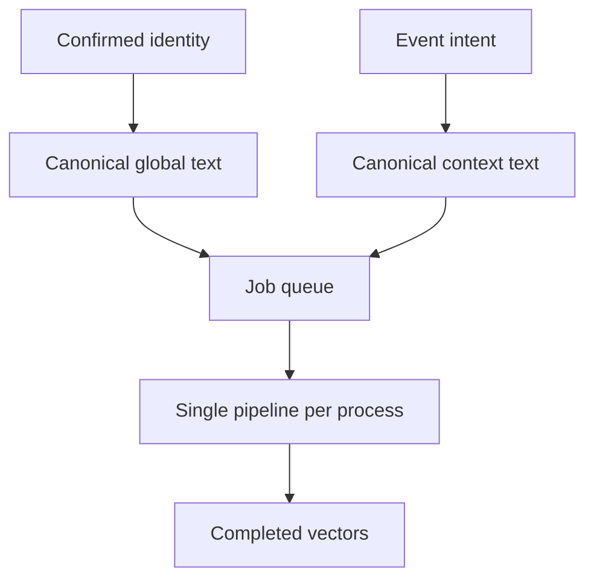

# Embeddings

Both profiles use the `query: ` prefix. It is not mixed with `passage: `, because person-to-person comparison is symmetric.

- `event_context_embeddings`: one vector per person and event.
- Not regenerated if hash, revision, and `completed` status still hold.
- A two-minute lease recovers abandoned work. At most three attempts.

Global text includes role, summary, interests, skills, projects, offer, focus, and topics. Contextual text includes intent, what they seek, and event metadata. No secrets.

In this repository the queue persists in the file store. `npm run worker:embeddings` drains it in a Node process. The server also starts it on confirm or join without blocking the response. The pgvector HNSW index is in `supabase/migrations/0003_intelligence.sql` and must be applied in the project. Until then, viewer search is brute force over event attendees, not over every pair.
