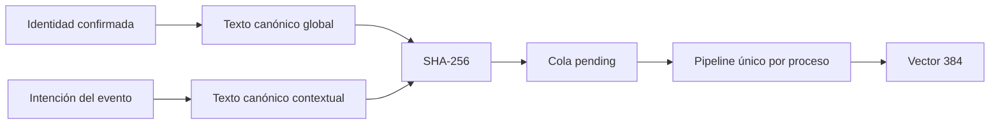

# Embeddings

Modelo: `Xenova/multilingual-e5-small` (`intfloat/multilingual-e5-small`). 384 dimensiones. Mean pooling y L2 los aplica el pipeline de `@huggingface/transformers`.

Los dos perfiles usan el prefijo `query: `. No se mezcla con `passage: `, porque la comparación entre personas es simétrica.

- `profile_embeddings`: un vector global por persona.
- `event_context_embeddings`: un vector por persona y evento.
- No se regenera si el hash, la revisión y el estado `completed` siguen vigentes.
- Estados: `pending`, `processing`, `completed`, `failed`.
- Un lease de dos minutos recupera un trabajo abandonado. Máximo tres intentos.

El texto global incluye rol, resumen, intereses, habilidades, proyectos, oferta, foco y temas. El contextual incluye la intención, lo que busca y los metadatos del evento. No incluye secretos.

En este repositorio la cola persiste en el almacén de archivo. `npm run worker:embeddings` la drena en un proceso Node. El servidor también la arranca al confirmar o al entrar, sin bloquear la respuesta. El índice HNSW de pgvector está en `supabase/migrations/0003_intelligence.sql` y hay que aplicarlo en el proyecto. Hasta entonces la búsqueda del visor es fuerza bruta sobre los asistentes del evento, no sobre todas las parejas.

El layout de Signal Field sigue usando el feature hashing de 48 dimensiones. Los 384 valores no se convierten en coordenadas.
