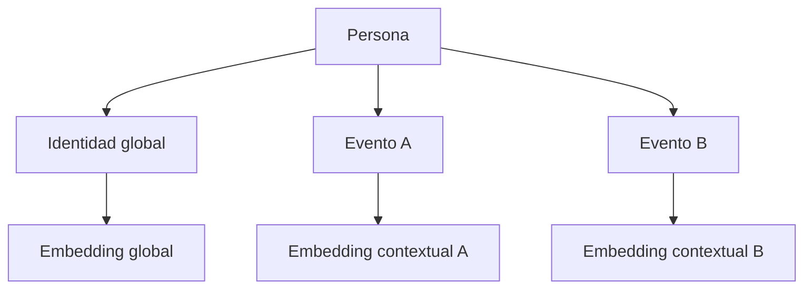

# Contexto de evento

La identidad global y el contexto del evento no se mezclan.

| Global, reutilizable | Por participación |
| --- | --- |
| Rol, bio, intereses, habilidades, proyectos, oferta, foco, temas | Evento, intención libre, visibilidad, consentimiento, estado |

Salir de la visibilidad —el control Invisible que ya existe— pone el consentimiento en falso y oculta a la persona en ese evento. No apaga su identidad ni las recomendaciones de otros eventos.

La presencia digital sigue sin ser proximidad física. QR, enlace y NFC no cambian. NFC solo aparece donde el navegador expone `NDEFReader` en un contexto seguro.

Los embeddings y las explicaciones no son públicos. RLS está activo en las tablas nuevas y no hay política para el rol anónimo: solo el servidor, con la service role, las lee. `MODEL_API_KEY` no sale del servidor.

Al entrar en un evento no se llama a Meta. Solo se programa el embedding que falte y se recalculan las recomendaciones de ese visor.
