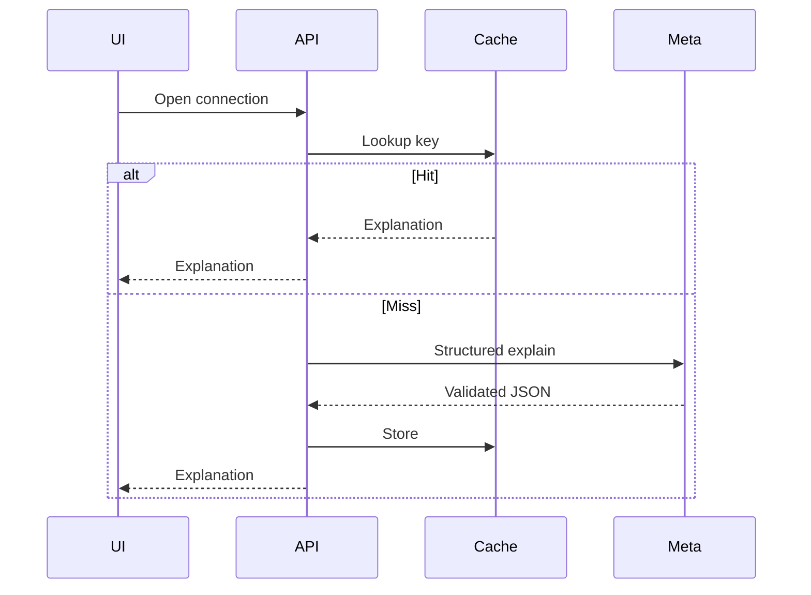

# Meta explanation cache

Opening a connection does not call Muse Spark if the evidence has not changed.

The SHA-256 key is directional and includes event, revisions and hashes of both profiles and their contexts, the ranking fingerprint, prompt version, model, and locale `en`.

Reservation is atomic in the store. A concurrent request sees `processing` and waits. A 30-second lease recovers abandoned work. There are three attempts.

The model receives confirmed identities, event contexts, and the signals already computed. It does not receive the 384-d vector. It does not write scores. Zod validates the output. A signal not in the allowed lists is not stored as a valid explanation.

Intentional regenerate (`regenerate`) ignores a cache hit. A profile or context change changes the key, so the old explanation stops being served without deleting those from other events.
