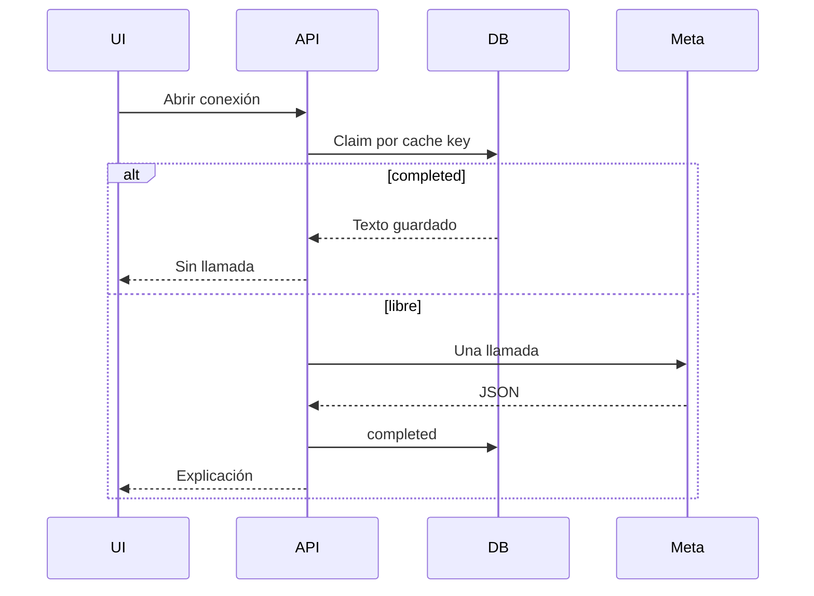

# Caché de explicaciones Meta

Abrir una conexión no llama a Muse Spark si la evidencia no ha cambiado.

La clave SHA-256 es direccional e incluye evento, revisiones y hashes de los dos perfiles y de sus contextos, la huella del ranking, la versión del prompt, el modelo y el locale `es`.

La reserva es atómica en el almacén. Otra petición simultánea ve `processing` y espera. Un lease de 30 segundos permite retomar un trabajo abandonado. Hay tres intentos.

El modelo recibe identidades confirmadas, contextos del evento y las señales ya calculadas. No recibe el vector de 384. No escribe puntuaciones. Zod valida la salida. Una señal que no está en las listas permitidas no se guarda como explicación válida.

Los tokens se anotan solo si la API los devuelve. No hay un precio inventado.

Regenerar a propósito (`regenerate`) ignora el acierto de caché. Un cambio de perfil o de contexto cambia la clave, así que la explicación vieja deja de servirse sin borrar las de otros eventos.
