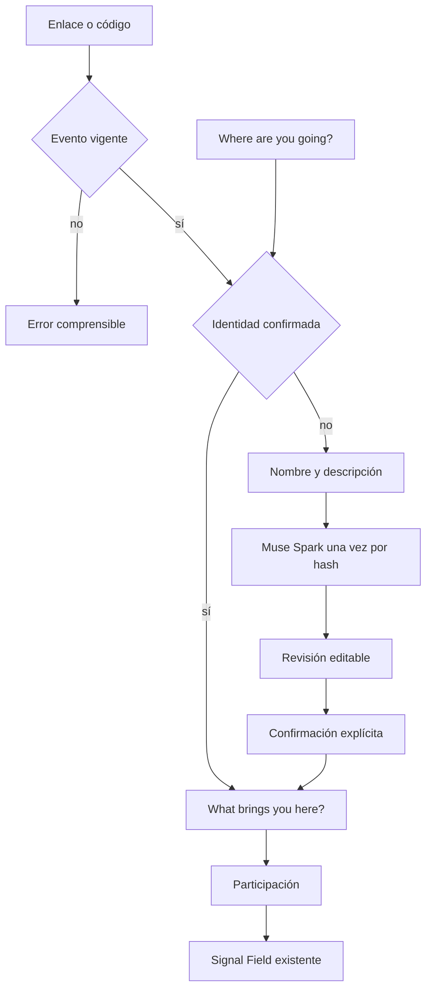

# Onboarding — evento primero

La identidad profesional se crea una vez. Cada evento añade un objetivo distinto.

1. El usuario elige un evento real, entra con código o crea uno. No hay eventos inventados. El conteo sale de `presence`.
2. Si no hay identidad confirmada, solo pide nombre y descripción libre.
3. Meta normaliza. La persona corrige y pulsa «Looks good — Save my identity».
4. Un texto opcional guarda el contexto de ese evento. No llama a Meta.
5. Quien ya confirmó su identidad no la reescribe al cambiar de evento.

La pantalla sustituye el formulario largo anterior. Signal Field no cambia de presentación.
