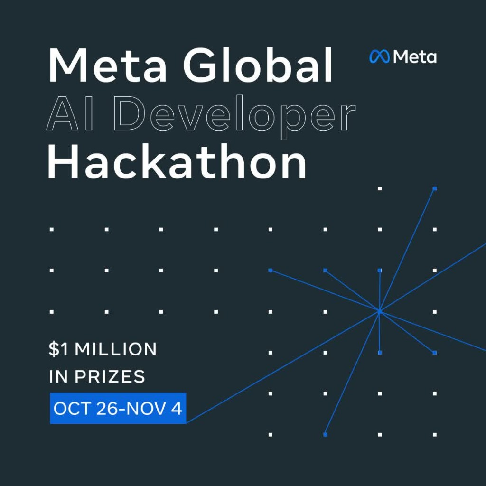

# IntroMesh



Discover who you should meet, understand why you connect, and make the introduction happen.

IntroMesh is built for the **Meta Global AI Developer Hackathon 2026**. It is a layer for in-person events. The loop is one: **Discover → Understand → Connect → Learn**. It is not a social network, a chat app, or a loose dashboard.

## Problem

At an event it is hard to know who to talk to and why. Attendee lists do not explain the conversation. IntroMesh shows who is visible, why they fit you, and leaves the connection in both people’s hands.

## Meta AI

The `muse-spark-1.3` model is called from the server with the OpenAI SDK and `MODEL_API_KEY`, against `https://api.meta.ai/v1`. It does three things, always with structured output and Zod:

1. Draft a presentation from profile fields without adding facts.
2. Explain a recommendation already chosen by deterministic ranking.
3. Propose an opening line. You can edit, discard, or regenerate it.

If the response cites an interest or skill that is not in the data, it is rejected. Nothing is replaced with invented text.

Without `MODEL_API_KEY` the UI says so and uses a **demo** draft built only from declared fields. That is not a Meta response.

## Start

```bash
npm install
cp .env.example .env.local
npm run dev
```

Open http://localhost:3000.

Persistence is **Supabase only**. Apply the SQL in `supabase/APPLY.md` (migrations `0001` → `0004`), then set `NEXT_PUBLIC_SUPABASE_URL`, `NEXT_PUBLIC_SUPABASE_ANON_KEY`, and `SUPABASE_SERVICE_ROLE_KEY`. The demo room is the 28 labeled profiles from `0002_demo_seed.sql`.

## Variables

| Variable | Use |
| --- | --- |
| `MODEL_API_KEY` | Meta Model API. Server only |
| `META_MODEL_BASE_URL` | Defaults to `https://api.meta.ai/v1` |
| `META_MODEL_ID` | Defaults to `muse-spark-1.3` |
| `NEXT_PUBLIC_SUPABASE_URL` | Project URL. Required |
| `NEXT_PUBLIC_SUPABASE_ANON_KEY` | Public anon key. Required |
| `SUPABASE_SERVICE_ROLE_KEY` | Server only. Required for reads/writes |

## Try the flow

1. Create your identity. Pick catalog interests (`models`, `product`…) to overlap the demo community.
2. Press **Active** or **Seeking**. Session presence expires after 90 seconds if abandoned.
3. Select a highlighted node. The list below is the same information for keyboard and mobile.
4. Read the explanation. Without a key, the label is “Demo, not Meta AI”.
5. Request the connection and, if the other person is a fixture, **Simulate accept**.
6. Copy the link or open the QR. NFC only appears in Chrome for Android, in a secure context, and writes a tag: it does not detect other phones.
7. Open **Intelligence**. Numbers come from stored events. Topics with fewer than five cases are hidden.

## 60–90 second demo

1. Join, save a profile with a hackathon goal and interest `models`.
2. Turn on presence.
3. Select a demo node with a shared interest.
4. Show the labeled explanation.
5. Request and simulate acceptance.
6. Show the QR.
7. Open Intelligence and point out that aggregates are not a people ranking.

## Checks

```bash
npm test
npm run lint
npm run build
npm run verify:meta
```

`verify:meta` only calls Meta when a key is present.

## Repository map

| Folder | What it is |
| --- | --- |
| `src/app` | Pages and HTTP routes |
| `src/components` | Signal field, profile, theme |
| `src/server` | The loop, one file per step: `session`, `presence`, `discover`, `explain`, `connect`, `learn` |
| `src/domain` | Pure rules. `matching` scores. `embedding` places the graph |
| `src/lib` | Session, theme, store, Supabase, and Meta client |
| `docs` | Architecture, design, privacy, and product |
| `supabase/migrations` | Schema for when a project exists |
| `scripts` | Meta checks and the demo seed |

## Decisions

- Ranking is deterministic: goals×3, interests×2, skills×1, complements×2. Meta does not scan the room.
- The graph vector is local: declared labels, not a Meta embedding. That API does not document embeddings.
- In-app presence is not physical distance.
- Organizers see aggregates. That view has no individual history.

## Contribute

Branches, commits, issues, and pull requests are in [CONTRIBUTING.md](CONTRIBUTING.md). Collaboration norms are in [CODE_OF_CONDUCT.md](CODE_OF_CONDUCT.md). Report a vulnerability as described in [SECURITY.md](SECURITY.md).

The code is published under the [MIT](LICENSE) license.
