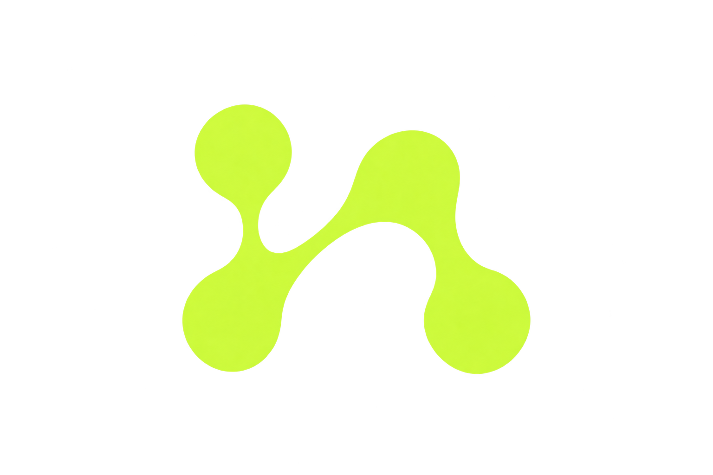
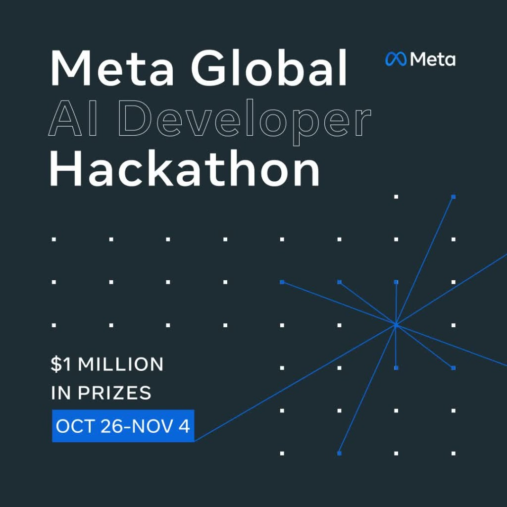
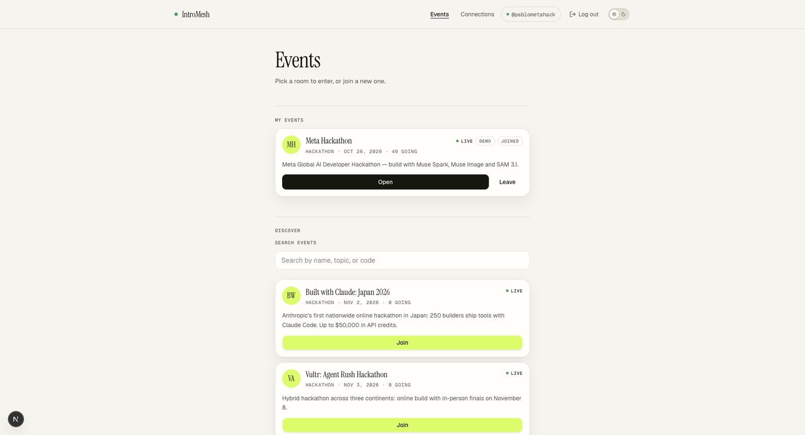
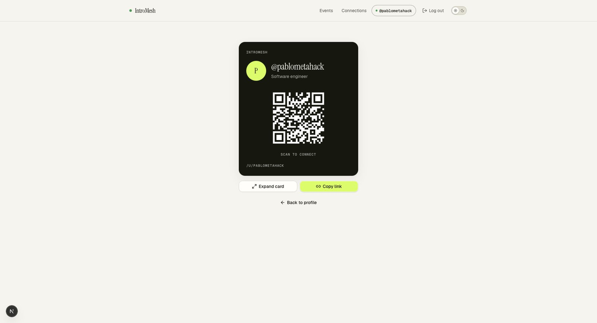
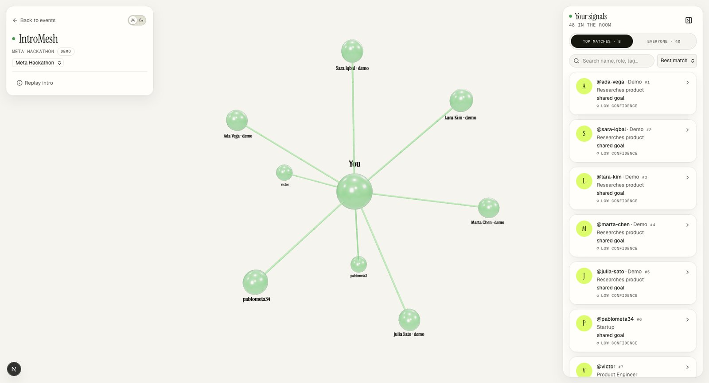
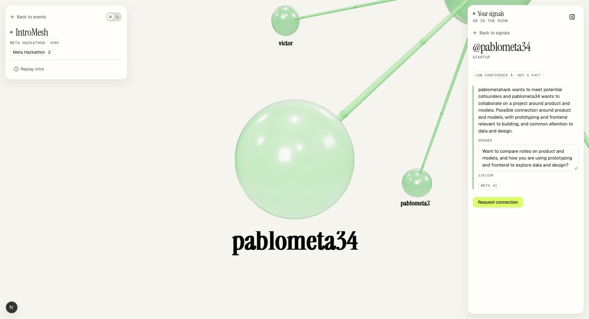
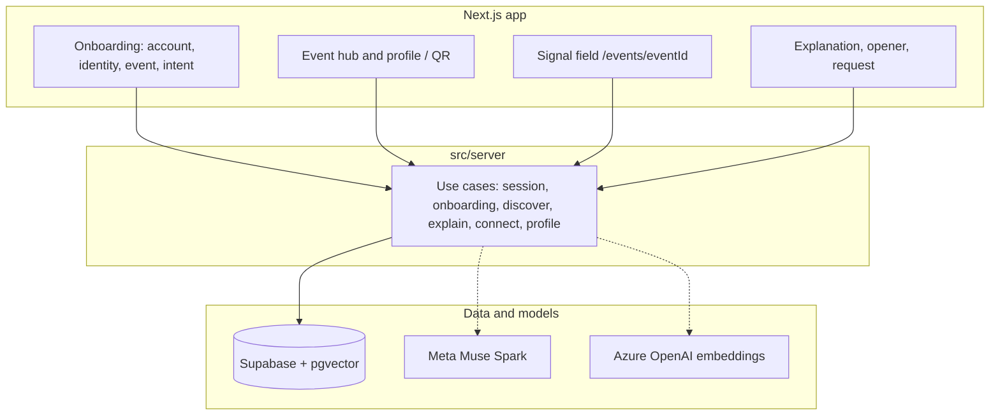

<p align="center">
  
</p>

<h1 align="center">IntroMesh</h1>

<p align="center">
  <strong>Discover who you should meet, understand why you connect, and make the introduction happen.</strong><br>
  An AI layer for in-person events: one identity, a 3D room, and introductions that stay in both people's hands.
</p>

<p align="center">
  
  
  
  
  
</p>

<p align="center">
  <a href="#-about">About</a> •
  <a href="#-demo">Demo</a> •
  <a href="#-screenshots">Screenshots</a> •
  <a href="#-features">Features</a> •
  <a href="#-tech-stack">Tech stack</a> •
  <a href="#-architecture">Architecture</a> •
  <a href="#-repository-structure">Repository</a> •
  <a href="#-getting-started">Getting started</a>
</p>

---

## 📌 About



**IntroMesh** is an open-source networking platform for real-world events, built for the **Meta Global AI Developer Hackathon 2026**.

You claim one `@` handle, describe yourself in plain language, and join a room. The app shows who else is there, why they fit you, and leaves the introduction in both people's hands. It is not a social network or a chat app: there is no public feed, and a connection only happens when the other person accepts.

### 🎯 Goals

- Give every attendee a single identity they can reuse across events.
- Rank who to meet with deterministic, evidence-based scoring — Meta AI explains a match that already exists; it does not scan the room or invent facts.
- Make the room readable at a glance: a 3D field of people, with the same list on the side for keyboard and mobile.
- Let both people control the introduction (request, accept, or decline) and share a public card by link or QR.

## 🎥 Demo


https://github.com/user-attachments/assets/1975b968-e3f7-457a-8aac-23906e4ff7b7


## 📸 Screenshots

<table>
  <tr>
    <td align="center" width="50%">
      <br>
      <sub>Event hub — join a room or open one you already entered</sub>
    </td>
    <td align="center" width="50%">
      <br>
      <sub>Public card with QR — share a link or let someone scan to connect</sub>
    </td>
  </tr>
  <tr>
    <td align="center" width="50%">
      <br>
      <sub>Signal field — you at the center, recommended people in orbit, same data in the side list</sub>
    </td>
    <td align="center" width="50%">
      <br>
      <sub>Match detail — grounded explanation, editable opener, then request the connection</sub>
    </td>
  </tr>
</table>

## ✨ Features

### 👤 Identity

- Register with a unique `@` handle and a password. One identity is reused at every event.
- Describe yourself in free text. **Muse Spark** (`muse-spark-1.3`) turns that description into a structured, editable profile (role, skills, what you offer, who you want to meet).
- You review the draft before it is saved. If a phrase is not in your text, it is rejected — nothing is replaced with invented copy.
- Without `MODEL_API_KEY`, the UI says so and you fill the profile by hand. That response is not presented as Meta's.

### 🏛️ Events and the room

- Browse live and upcoming rooms, search by name, topic, or code, and join with a short intent for that event.
- Opening a room starts a short four-step intro, then the **signal field**: a 3D graph with you at the center and recommended people on threads around you.
- The **Your signals** rail shows the same neighborhood as a list (top matches, or everyone going), searchable and usable from a keyboard or a phone.
- Membership is what makes you visible. There is no separate live-presence toggle.

### 🤝 Matching and introductions

- Ranking is computed on the write path: a hybrid score over semantic similarity (Azure embeddings), goals, interests, complements, and event context. The top 8 recommendations are persisted and then read back — discovery never re-scores the room.
- Selecting a person asks Meta for a structured explanation and an opening line, grounded in stored evidence. You can edit, discard, or regenerate the opener.
- Request a connection; only the real recipient can accept or decline it.
- Share your public card with a link or a QR (and a vCard). The card is also reachable at `/u/<username>` and `/p/<slug>`.

## 🛠️ Tech stack

| Layer | Technologies |
|------|-------------|
| App | Next.js 16, React 19, TypeScript, Tailwind CSS |
| 3D field | Three.js and `react-force-graph-3d` (deterministic pair-hash seeds, then a force simulation) |
| Data | Supabase (Postgres, pgvector, Row Level Security). Persistence is Supabase only |
| Auth | `@` handle + password, session cookie signed with `SESSION_SECRET` |
| Meta AI | OpenAI SDK against `https://api.meta.ai/v1`, model `muse-spark-1.3`, structured output validated with Zod |
| Embeddings | Azure OpenAI `text-embedding-3-small` (1536 dimensions), processed inline with `after()` after save/join |
| Tests | Vitest, ESLint |

## 🏛️ Architecture

The browser talks only to Next.js route handlers. Those handlers call one use case each in `src/server`. Domain rules (scoring, Zod schemas, grounding) stay in `src/domain`. The client never receives `MODEL_API_KEY` or the Supabase service role.



On confirm or join, an embedding job is enqueued and processed inline with `after()` — no always-on worker is required to deploy. `npm run worker:embeddings` and `npm run backfill:embeddings` are laptop tools for retries and old rows.

The full product journey is in [docs/FLOW.md](docs/FLOW.md). Matching and embeddings are detailed in [docs/MATCHING.md](docs/MATCHING.md) and [docs/EMBEDDING.md](docs/EMBEDDING.md).

## 📂 Repository structure

```
IntroMesh/
├── src/app/                  # Pages and HTTP routes
│   ├── events/               # Hub and /events/[eventId] room
│   ├── profile/              # Your profile
│   ├── connections/          # Connection list
│   ├── u/[username]/         # Public profile by handle
│   ├── p/[slug]/             # Public card by slug
│   └── api/                  # session, auth, identity, events,
│                             # participation, discovery, affinity,
│                             # connections, profile
├── src/components/           # Onboarding, hub, signal field, profile, share
├── src/server/               # One use case per step of the loop
├── src/domain/               # Pure rules: matching, identity, embeddings, grounding
├── src/lib/                  # Session, Supabase store, Meta client, Azure embeddings, vCard
├── supabase/migrations/      # Schema 0001 → 0015; apply in order (see APPLY.md)
├── scripts/                  # Meta check, demo seed, embedding backfill / worker
├── docs/                     # Flow, architecture, matching, privacy, product
├── public/                   # Logo and event covers
└── README.md
```

## 🚀 Getting started

### Requirements

- Node.js 18+ (the app uses Next.js 16)
- A [Supabase](https://supabase.com) project

### Install and run

```bash
npm install
cp .env.example .env
npm run dev
```

Open http://localhost:3000.

### Supabase and environment

Persistence is **Supabase only**. In the Supabase SQL editor, apply the migrations in [`supabase/APPLY.md`](supabase/APPLY.md) **in order** (`0001` → `0015`), or run `supabase db push` from a CLI linked to the project. Migration `0002` seeds the demo Meta Hackathon room with 28 labeled profiles; later migrations add extra rooms and auth.

Then set the variables below in `.env`. Names and comments follow [`.env.example`](.env.example):

| Variable | Use |
| --- | --- |
| `NEXT_PUBLIC_SUPABASE_URL` | Project URL. Required |
| `NEXT_PUBLIC_SUPABASE_ANON_KEY` | Public anon key (protect it with RLS). Required |
| `SUPABASE_SERVICE_ROLE_KEY` | Server only. Required for reads and writes |
| `SESSION_SECRET` | Signs the session cookie. Required in production — without it, login and register fail |
| `MODEL_API_KEY` | Meta Model API. Server only. Create a key at [dev.meta.ai](https://dev.meta.ai) |
| `META_MODEL_BASE_URL` | Defaults to `https://api.meta.ai/v1` |
| `META_MODEL_ID` | Defaults to `muse-spark-1.3` |
| `AZURE_OPENAI_ENDPOINT` | Embedding provider. Server only |
| `AZURE_OPENAI_API_KEY` | Embedding provider. Server only |
| `AZURE_OPENAI_EMBEDDING_DEPLOYMENT` | Defaults to `text-embedding-3-small` |
| `AZURE_OPENAI_API_VERSION` | Defaults to `2024-10-21` |
| `INTROMESH_DATA_MODE` | `live` (default) or `demo` (allows labeled synthetic fixtures; it never fakes a model response) |
| `INTROMESH_ALLOW_EVENT_CREATE` | Set to `1` to allow creating events from onboarding; otherwise event creation stays closed |

Join and confirm enqueue embedding jobs that the server processes inline. For retries or old rows, from a laptop:

```bash
npm run backfill:embeddings
npm run worker:embeddings
```

### Checks

```bash
npm test
npm run lint
npm run build
npm run verify:meta
```

`verify:meta` only calls Meta when a key is present.

### 60–90 second walkthrough

1. Claim an `@` handle and create an account.
2. Write a short description with a clear goal (for example, meeting a cofounder) and an interest that overlaps the demo community. Review the Muse Spark draft and save it.
3. Choose the Meta Hackathon room and write why you are there, then join.
4. Open **Show my card** and the QR.
5. Open the event, go through the short intro, and look at the 3D field.
6. Select a highlighted node (or a row in **Your signals**). Read the Meta-grounded explanation and the opener; edit it if you want.
7. Request the connection. Accept or decline it from the recipient's side.
8. Share the public card with the link or the QR.

## 🏆 Hackathon

Built for the **Meta Global AI Developer Hackathon 2026**.

Muse Spark is used in three places, always with structured output and Zod: drafting the profile, explaining a recommendation that deterministic ranking already chose, and proposing an opening line. If the model cites an interest or skill that is not in the stored evidence, the response is rejected.

## 👥 Authors

| Author |
|--------|
| [Pablo Herrero](https://github.com/pablojhdcoder) |

## 📄 License

MIT — see [LICENSE](LICENSE).

How to contribute is in [CONTRIBUTING.md](CONTRIBUTING.md). Collaboration norms are in [CODE_OF_CONDUCT.md](CODE_OF_CONDUCT.md). Report a vulnerability as described in [SECURITY.md](SECURITY.md).
