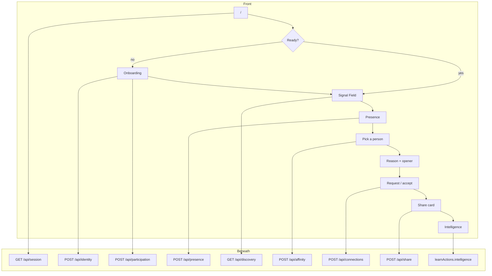

# IntroMesh — flow (front over backend)

How a person moves through the product, and what the server does under each screen. Deep dives stay in the other `docs/` files.

Success: an introduction **accepted by both people**, with a **concrete reason**, without showing anyone who did not consent.

After join, the product loop is **Discover → Understand → Connect → Learn**.

```
Browser UI
  src/app  src/components
        │
        │  fetch JSON only — no MODEL_API_KEY, no service role
        ▼
Route handlers          src/app/api/*/route.ts
        │
        ▼
Use cases               src/server  (createService in index.ts)
        │
        ├── Domain rules      src/domain   (score, presence, Zod, grounding)
        ├── Persistence       src/lib/store → Supabase (service role)
        ├── Session cookie    src/lib/session
        └── Meta (optional)   src/lib/meta  muse-spark-1.3, Responses API
```



---

## 1. Open `/`

**Front.** `SignalApp` mounts. Loading, then either onboarding or the field.

**Beneath.** `GET /api/session` → `sessionActions.session`.

- Cookie `src/lib/session` holds the profile id. Missing cookie → anonymous.
- Store lookup: `identities` (confirmed?), `participations` (joined event?), `profiles`.
- Response: `needsSetup`, `identityConfirmed`, `draft`, `event`, `metaConfigured`, `canCreateEvent`.
- Ready = confirmed identity **and** a joined event. Otherwise onboarding.
- The browser never opens Supabase with the service role and never calls `api.meta.ai`.

---

## 2. Join — event, identity, intent

**Front.** Event first. Identity once. Intent per event.

| Screen | Person does |
| --- | --- |
| Where are you going? | Search, pick a live event, code/link, or create if allowed |
| Let's get to know you | Name + free-form description |
| Your identity | Review / edit → Save identity |
| What brings you here? | Optional intent + consent to be discoverable |

Already confirmed identity skips the description/review when changing events.

**Beneath — events.** `GET/POST /api/events` → `onboardingActions.listEvents` / `resolveEvent` / `createEvent`.

- Ended events are hidden. Attendee counts = live `presence` rows (session or labeled `demo`).
- Create is gated by `INTROMESH_ALLOW_EVENT_CREATE=1`. No invented rooms.

**Beneath — normalize.** `POST /api/identity` `{ action: "normalize" }` → `onboardingActions.normalizeIdentity`.

- Zod `identityDraftSchema`. SHA-256 of the description. Same hash → reuse (`source: "cache"`), no Meta.
- No `MODEL_API_KEY` → HTTP 503, `error: "meta"`, draft saved, UI goes manual. Not a fake model profile.
- With key: `normalizeDescription` in `src/lib/meta/normalize` (Muse Spark, structured Zod). Lists are cleaned against the source text. Sensitive phrases stripped before the prompt.
- Sets the session cookie to `userId`.

**Beneath — confirm.** `POST /api/identity` `{ action: "confirm" }` → `confirmIdentity`.

- Writes `identities.confirmed`, `status: confirmed`, bumps `revision`.
- Projects into `profiles` via `toProfileInput`. Missing role → `Participant`.
- Clears recommendation rows where this person is viewer or candidate.
- Enqueues a **global** embedding job (`scheduleEmbedding`). `processEmbeddingQueue` starts after the response (does not block).
- Editing structured fields does not call Meta.

**Beneath — join.** `POST /api/participation` → `joinEvent`.

- Requires confirmed identity + live event.
- Writes `participations`: intent, consent, visibility (`discoverable` | `hidden`). Meta is **not** called.
- If there is intent text, enqueues an **event** embedding job.
- Clears this event’s recommendations that involve the joiner.
- Consent true → session `presence` `active` with 90s expiry. Consent false → no presence row.
- May copy intent into `profile.seeking` for the field.

| Store (global) | Store (this event) |
| --- | --- |
| `identities`, `profiles` | `participations`, session `presence` |

---

## 3. Discover — field and list

**Front.** IntroMesh header, event name, Demo mark if the room is a fixture. Presence: Invisible / Active / Seeking. Graph on the left, list on the right. Mobile (`< 720px`): compact field + list. Presence is not GPS and not two phones finding each other.

**Beneath — presence.** `POST /api/presence` every 20s while visible → `presenceActions.setPresence`.

- Invisible: drop session presence; `consent = false`, `visibility = hidden`. Identity is unchanged.
- Active / Seeking: session row, `expiresAt` = now + 90s. Demo presence is refreshed in discovery, not by this heartbeat.
- Abandoned tab expires; closing the tab is not the privacy switch — Invisible is.

**Beneath — room.** `GET /api/discovery` → `discoverActions.discover`.

1. Drop expired non-demo presence. Keep demo fixtures alive for the hackathon room.
2. If the viewer is not live, `people: []`.
3. `refreshViewerRecommendations`: visible pool at this event only (consent + live presence). Optional hybrid retrieve (E5 vectors in `embeddings`) at most 24, then score, persist at most 8 in `recommendations`. No all-pairs over the whole database.
4. Field layout: **local** feature hash (`embedProfile` / `mapSignalGraph` in `src/domain/embedding`). Meta has no embeddings API. Angle = vector, not random. Up to 18 neighbors.
5. Ranker in the room: `selectCandidates`, `score = goals×3 + interests×2 + skills×1 + complements×2`. Need overlap. Max **8** recommendations (threads). If both global E5 vectors exist, hybrid `finalScore` can label the edge; otherwise the formula above so the demo room does not jump.
6. Each person: public card + `recommendation | null` + `demo`.

Meta does not choose who appears.

---

## 4. Understand — why this person

**Front.** Tap a node or list row. Evidence ≤ 3. Then summary, opener, badge `Meta AI` or `Demo`. Errors: not enough evidence, turn on presence, Meta returned no explanation.

**Beneath.** `POST /api/affinity` → `explainActions.affinity`.

- Both must be live at the event. Else `error: "presence"`.
- Pair must already be a `selectCandidates` hit or a stored `recommendations` row. Else `error: "match"`. The model does not search the room.
- Cache key: event + both identity/context revisions and hashes + evidence fingerprint + ranking/prompt/model + locale `en` (`explanationCacheKey`). Hit → return, `cached: true`.
- Miss: atomic claim (`processing`, 30s lease, three attempts). Concurrent requests wait.
- `shouldCallMetaForAffinity`: no call if either profile is `demo` or `MODEL_API_KEY` is missing → `demoExplanation` from declared overlaps, `source: "demo"`.
- Otherwise `createStructuredResponse` (`src/lib/meta/client`). Prompt gets confirmed identities, intents, **allowed** signal lists, and already computed scores — not the 384-d vector. Zod `match_explanation`. Ungrounded terms → reject, no invented fill-in.
- Store completed explanation; analytics `profile_viewed` once per pair/event.
- `regenerate: true` ignores a cache hit.

---

## 5. Connect — request and accept

**Front.** Request connection (needs an explanation). Pending. Demo fixture: Simulate accept. Accepted: intro text stays on the panel.

**Beneath.** `POST /api/connections` → `connectActions`.

- Request: row `pending`, `intro` + `introSource` (`model` | `demo` | `user`), analytics `intro_requested`. Duplicate non-declined request is a no-op.
- Seeing a recommendation is not a relationship. Accept is independent of visibility.
- Resolve: `toId` may accept/decline. `simulateDemo` only if the target is `demo` and the caller is `fromId`.
- Accept → `accepted` + `connection_accepted` analytics. Decline stays declined.
- No email, phone, or chat payload. Public slug is enough to meet in the hall.

---

## 6. Learn — share and intelligence

**Front.** After accept: Copy link, QR, Write/Read NFC (if `NDEFReader` + secure context). Public page `/p/[slug]`. Intelligence: counts and topics.

**Beneath — share.** `POST /api/share` `{ method }` → `learnActions.share` (`share_link` | `share_qr` | `share_nfc`). QR image: `GET /api/profiles/[slug]/qr` (SVG, inverted in light). NFC is browser-only; the server does not detect phones.

**Beneath — public card.** `profileBySlug`. Only authorized public fields. Demo labeled. Connection still needs accept.

**Beneath — intelligence.** Page `/intelligence` → `learnActions.intelligence` → `aggregateActivity`. Visible = live presence. Topics with fewer than 5 cases hidden (`suppressedTopics`). No intro text, no people ranking. Organizers do not get private profiles.

---

## Meta vs code

| Front moment | Server always | Muse Spark |
| --- | --- | --- |
| Open app | Session cookie + store | No |
| Pick / join event | Events, participation | No |
| Continue on description | Hash, Zod, identity draft | Yes, once per new hash (or regenerate) |
| Save identity | Profile projection, embedding job | No |
| Presence toggle | Presence rows, consent | No |
| See the room | Presence filter, local vectors, `selectCandidates`, optional hybrid | No |
| Open a person | Cache + grounding | Yes, only if not demo, not cached, pair already ranked |
| Request / accept | Connections + analytics | No |
| Share / Intelligence | Analytics aggregates | No |

Without `MODEL_API_KEY`, Meta-shaped UI is a badge or one line. No simulated model JSON.

---

## Map

| Front | HTTP | Use case |
| --- | --- | --- |
| Boot | `GET /api/session` | `session` |
| Event list / code | `GET/POST /api/events` | `onboarding` |
| Description / save | `POST /api/identity` | `onboarding` |
| Join | `POST /api/participation` | `onboarding` |
| Invisible / Active / Seeking | `POST /api/presence` | `presence` |
| Field | `GET /api/discovery` | `discover` |
| Person detail | `POST /api/affinity` | `explain` |
| Intro | `POST /api/connections` | `connect` |
| Link / QR / NFC | `POST /api/share` | `learn` |
| `/intelligence` | server page | `learn` |

---

## Deep dives

| Topic | File |
| --- | --- |
| Layers, secrets, persistence | `ARCHITECTURE.md` |
| Identity + Muse Spark | `PROFILE_INTELLIGENCE.md`, `ONBOARDING.md` |
| Global vs event fields | `EVENT_CONTEXT.md` |
| Hybrid ranking | `MATCHING.md` |
| E5 queue vs field hashing | `EMBEDDING.md` |
| Explanation cache key | `META_AI_CACHE.md` |
| Consent | `PRIVACY.md` |
| UI tokens | `DESIGN.md` |
