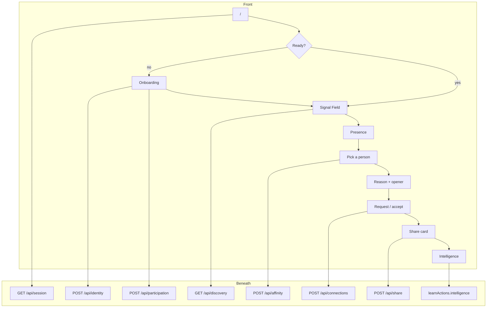

# IntroMesh — flow (front over backend)

How a person moves through the product, and what the server does under each screen. Deep dives stay in the other `docs/` files.

Success: an introduction **accepted by both people**, with a **concrete reason**, without showing anyone who did not consent.

After join, the product loop is **Discover → Understand → Connect → Learn**.

```
Browser UI
  src/app  src/components
        │
        │  fetch JSON only — no MODEL_API_KEY, no service role
        ▼
Route handlers          src/app/api/*/route.ts
        │
        ▼
Use cases               src/server  (createService in index.ts)
        │
        ├── Domain rules      src/domain   (score, Zod, grounding)
        ├── Persistence       src/lib/store → Supabase (service role)
        ├── Session cookie    src/lib/session
        └── Meta (optional)   src/lib/meta  muse-spark-1.3, Responses API
```



---

## 1. Open `/`

**Front.** `SignalApp` mounts. Loading, then either onboarding or the field.

**Beneath.** `GET /api/session` → `sessionActions.session`.

- Cookie `src/lib/session` holds the profile id. Missing cookie → anonymous.
- Store lookup: `identities` (confirmed?), `participations` (joined event?), `profiles`.
- Response: `needsSetup`, `identityConfirmed`, `draft`, `event`, `metaConfigured`, `canCreateEvent`.
- Ready = confirmed identity **and** a joined event. Otherwise onboarding.
- With the event hub (see `EVENT_HUB.md`), `/` resolves a returning confirmed user to `/events`; the active event then lives in the URL at `/events/[eventId]`, not in session state.
- The browser never opens Supabase with the service role and never calls `api.meta.ai`.

---

## 2. Join — event, identity, intent

**Front.** Event first. Identity once. Intent per event.

| Screen | Person does |
| --- | --- |
| Where are you going? | Search, pick a live event, code/link, or create if allowed |
| Let's get to know you | Name + free-form description |
| Your identity | Review / edit → Save identity |
| What brings you here? | Optional intent + consent to be discoverable |

Already confirmed identity skips the description/review when changing events.

**Beneath — events.** `GET/POST /api/events` → `onboardingActions.listEvents` / `resolveEvent` / `createEvent`.

- Ended events are hidden. Attendee counts = joined participations.
- Create is gated by `INTROMESH_ALLOW_EVENT_CREATE=1`. No invented rooms.

**Beneath — normalize.** `POST /api/identity` `{ action: "normalize" }` → `onboardingActions.normalizeIdentity`.

- Zod `identityDraftSchema`. SHA-256 of the description. Same hash → reuse (`source: "cache"`), no Meta.
- No `MODEL_API_KEY` → HTTP 503, `error: "meta"`, draft saved, UI goes manual. Not a fake model profile.
- With key: `normalizeDescription` in `src/lib/meta/normalize` (Muse Spark, structured Zod). Lists are cleaned against the source text. Sensitive phrases stripped before the prompt.
- Sets the session cookie to `userId`.

**Beneath — confirm.** `POST /api/identity` `{ action: "confirm" }` → `confirmIdentity`.

- Writes `identities.confirmed`, `status: confirmed`, bumps `revision`.
- Projects into `profiles` via `toProfileInput`. Missing role → `Participant`.
- Clears recommendation rows where this person is viewer or candidate.
- Enqueues a **global** embedding job (`scheduleEmbedding`). The job is processed inline with `after()` after the response; no separate always-on service is required.
- Editing structured fields does not call Meta.

**Beneath — join.** `POST /api/participation` → `joinEvent`.

- Requires confirmed identity + live event.
- Writes `participations`: intent, `consent = true`, `visibility = discoverable` (joining is consent — social model). Meta is **not** called.
- If there is intent text, enqueues an **event** embedding job. Embedding and recommendation recompute run inline with `after()` after the response; `npm run worker:embeddings` and `npm run backfill:embeddings` are laptop backfill/retry tools only.
- Clears this event’s recommendations that involve the joiner.
- Recomputes the joiner's list and inserts them into other members' lists immediately (`refreshViewerRecommendations` + `insertCandidateAgainstViewers`), so a registered member appears without anyone being online.
- May copy intent into `profile.seeking` for the field.

| Store (global) | Store (this event) |
| --- | --- |
| `identities`, `profiles` | `participations` |

---

## 3. Discover — field and list

**Front.** IntroMesh header, event name, Demo mark if the room is a fixture. `Leave event` in the header returns to the event picker at any time (identity is kept); the empty room also offers `Join a different event`. First visit shows the cinematic intro once per event (This is you → reveal → legend) with Skip + Replay. Graph on the left, list on the right. Mobile (`< 720px`): compact field + list. Everyone shown is registered for the event; there is no online/offline state and no GPS or phone detection.

**Beneath — room.** `GET /api/discovery` → `discoverActions.discover`. Read-only: it never embeds, scores, or rewrites recommendations.

Rule: a member sees every other member with `status = "joined"`. No presence, no heartbeat, no expiry. If the viewer is not joined, `people: []` and `directory: []`.

1. Read this viewer’s persisted top-8 `recommendations` rows for the event (written by the embedding worker), sorted by `finalScore`. No `refreshViewerRecommendations`, no `selectCandidates`, no vector work on this path.
2. Field layout: deterministic `pointForPair(viewerId, candidateId)` hash position. Stable across renders and processes. No embeddings and no feature hashing on the read path. Up to 8 neighbors.
3. Each person: public card + persisted `recommendation` (score, confidence, stored evidence labels) + `demo`.
4. `directory` ("Everyone going"): every other joined member not in the top-8, as public cards with no scores, sorted by name (capped at 100).
5. `viewerEmbeddingStatus`: `pending` until the global embedding job completes or persisted rows exist, then `ready`.

Meta does not choose who appears. Embeddings only build the list on the write path; the discovery read path never reads vectors.

---

## 4. Understand — why this person

**Front.** Tap a node or list row. Evidence ≤ 3. Then summary, opener, badge `Meta AI` or `Demo`. Errors: not enough evidence, join-the-event prompt, Meta returned no explanation.

**Beneath.** `POST /api/affinity` → `explainActions.affinity`.

- Both must hold joined participations in this event. Else `error: "presence"` (legacy value kept for API compatibility). Fixtures get no bypass.
- Pair must already have a persisted `recommendations` row from the write path. Else `error: "match"`. The model does not search the room.
- Cache key: event + both identity/context revisions and hashes + evidence fingerprint + ranking/prompt/model + locale `en` (`explanationCacheKey`). Hit → return, `cached: true`.
- Miss: atomic claim (`processing`, 30s lease, three attempts). Concurrent requests wait.
- No-key or model failure → `error: "meta"`. No fabricated text is ever returned.
- With key: `createStructuredResponse` (`src/lib/meta/client`). Prompt gets confirmed identities, intents, **stored evidence labels**, and already computed scores — not the embedding vector. Zod `match_explanation`. Ungrounded terms → reject, no invented fill-in.
- Store completed explanation; analytics `profile_viewed` once per pair/event.
- `regenerate: true` ignores a cache hit.

---

## 5. Connect — request and accept

**Front.** Request connection (needs an explanation). Pending. Accepted: intro text stays on the panel.

**Beneath.** `POST /api/connections` → `connectActions`.

- Request: row `pending`, `intro` + `introSource` (`model` | `user`), analytics `intro_requested`. Duplicate non-declined request is a no-op. `introSource` values other than `model`/`user` are rejected.
- Seeing a recommendation is not a relationship. Accept is independent of visibility.
- Resolve: only `toId` may accept/decline. No simulated accept path.
- Accept → `accepted` + `connection_accepted` analytics. Decline stays declined.
- No email, phone, or chat payload. Public slug is enough to meet in the hall.

---

## 6. Learn — share and intelligence

**Front.** After accept: Copy link, QR, Save contact (.vcf). Public page `/p/[slug]`. Intelligence: counts and topics.

**Beneath — share.** `POST /api/share` `{ method }` → `learnActions.share` (`share_link` | `share_qr` | `share_vcard`). QR image: `GET /api/profiles/[slug]/qr` (SVG, inverted in light).

**Beneath — public card.** `profileBySlug`. Only authorized public fields. Demo labeled. Connection still needs accept.

**Beneath — intelligence.** Page `/intelligence` → `learnActions.intelligence` → `aggregateActivity`. Members = joined participations. Topics with fewer than 5 cases hidden (`suppressedTopics`). No intro text, no people ranking. Organizers do not get private profiles.

---

## Meta vs code

| Front moment | Server always | Muse Spark |
| --- | --- | --- |
| Open app | Session cookie + store | No |
| Pick / join event | Events, participation | No |
| Continue on description | Hash, Zod, identity draft | Yes, once per new hash (or regenerate) |
| Save identity | Profile projection, embedding job | No |
| See the room | Joined members + persisted top-8, deterministic layout | No |
| Open a person | Cache + grounding | Yes, always when not cached; no key → 503 `meta` |
| Request / accept | Connections + analytics | No |
| Share / Intelligence | Analytics aggregates | No |

Without `MODEL_API_KEY`, Meta-shaped UI is a badge or one line. No simulated model JSON.

---

## Map

| Front | HTTP | Use case |
| --- | --- | --- |
| Boot | `GET /api/session` | `session` |
| Event list / code | `GET/POST /api/events` | `onboarding` |
| Description / save | `POST /api/identity` | `onboarding` |
| Join | `POST /api/participation` | `onboarding` |
| Leave event | `POST /api/participation` (`action: "leave"`) | `onboarding` |
| Field | `GET /api/discovery` | `discover` |
| Person detail | `POST /api/affinity` | `explain` |
| Intro | `POST /api/connections` | `connect` |
| Link / QR / vCard | `POST /api/share` | `learn` |
| `/intelligence` | server page | `learn` |
| `/events` | server page | Event hub: My Events vs Discover (`EVENT_HUB.md`) |
| `/events/[eventId]` | server page | Active event; the Signal Field scoped to this event |
| `/profile` | server page | Own global identity: visibility, avatar, username |
| `/u/[username]` | server page | Public card for `profiles.slug` when `profile_visibility = public`; no card when `private` |

---

## Deep dives

| Topic | File |
| --- | --- |
| Layers, secrets, persistence | `ARCHITECTURE.md` |
| Identity + Muse Spark | `PROFILE_INTELLIGENCE.md`, `ONBOARDING.md` |
| Global vs event fields | `EVENT_CONTEXT.md` |
| Hybrid ranking | `MATCHING.md` |
| Azure embedding queue and write path | `EMBEDDING.md` |
| Explanation cache key | `META_AI_CACHE.md` |
| Consent | `PRIVACY.md` |
| Global identity + username | `GLOBAL_IDENTITY.md` |
| Event hub, switch vs leave | `EVENT_HUB.md` |
| Multi-event tables, migration `0007` | `MULTI_EVENT_ARCHITECTURE.md` |
| Global connections, origin event | `CONNECTIONS_ARCHITECTURE.md` |
| UI tokens | `DESIGN.md` |
