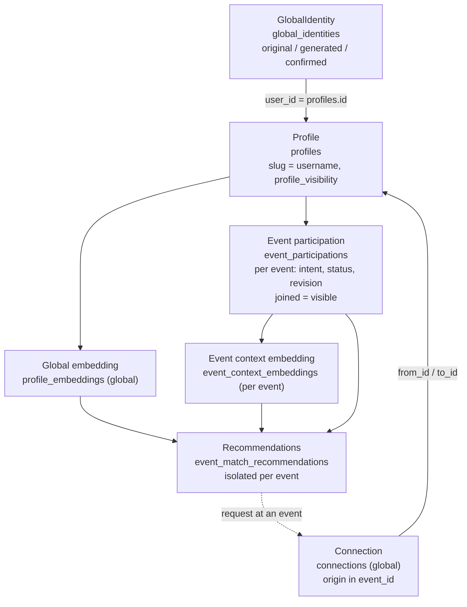

# Multi-event architecture — IntroMesh

Status: implemented in migrations `0007` and `0009`. Existing tables keep their names; `0007` only adds columns and indexes, `0009` backfills joined members to visible and drops the `presence` table.

## Table map (no renames)

| Concept | Existing table | Key fields |
| --- | --- | --- |
| Global identity | `global_identities` | `user_id` (PK, = `profiles.id`), `original_description`, `generated`, `confirmed`, `input_hash`, `revision`, `status` |
| Public profile | `profiles` | `id`, `slug` (unique username), `display_name`, `role`, declared lists, `goal`, `demo` |
| Event | `events` | `id`, `code`, `status`; ended events hidden |
| Membership | `event_participations` | PK `(user_id, event_id)`; `intent_text`, `status` (`joined`/`left`), `revision`, `input_hash`. `joined` = visible at that event |
| Global embedding | `profile_embeddings` | One row per `user_id`, from the confirmed identity |
| Event embedding | `event_context_embeddings` | PK `(user_id, event_id)`, from that event's intent/context |
| Recommendations | `event_match_recommendations` | PK `(event_id, viewer_id, candidate_id)`. Rows never leak across events |
| Connection | `connections` | `from_id`, `to_id`, `status`; `event_id` is the origin event (see `CONNECTIONS_ARCHITECTURE.md`) |

## Migration `0009` (membership visibility)

- Backfills `consent = true`, `visibility = 'discoverable'` for `status = 'joined'` rows (legacy columns kept, code no longer reads them).
- `drop table if exists presence`: no heartbeat, no TTL, no online state.

## Migration `0007` additions

Additive only. No table or column renames.

| Change | Why |
| --- | --- |
| `profiles.profile_visibility text not null default 'private'` check (`public`, `private`) | Public username page is opt-in (see `GLOBAL_IDENTITY.md`) |
| `profiles.avatar_url text` (nullable) | Avatar is optional |
| Unique partial index on `connections` over the canonical pair — `(least(from_id, to_id), greatest(from_id, to_id))` — where `status in ('pending', 'accepted')` | One live connection per pair, in either direction |
| Index on `event_participations (user_id, status)` | My Events lookup for the hub |

Everything else already exists: participations (`0003`, `0004`), embeddings and recommendations (`0003`–`0006`), origin `connections.event_id` (`0001`).

## Auth and access

- Session: signed httpOnly cookie `im_profile` (`src/lib/session`). It seals the profile id; `userId` everywhere in `global_identities` and `event_participations` is that `profiles.id`.
- There is no Supabase Auth user and no per-event login. Switching events never changes the cookie.
- RLS is enabled on every table above, with no policy for the anon role: anon is denied. All reads and writes go through the server with `SUPABASE_SERVICE_ROLE_KEY`. Secrets never reach the client.

## Isolation rules

- A recommendation or explanation row at one event says nothing at another event.
- Leaving affects only that event's participation; switching is navigation only. Connections are global and survive (see `CONNECTIONS_ARCHITECTURE.md`).
- Deterministic candidates first, per event. Meta only explains a persisted recommendation; it never ranks or scans the room.
