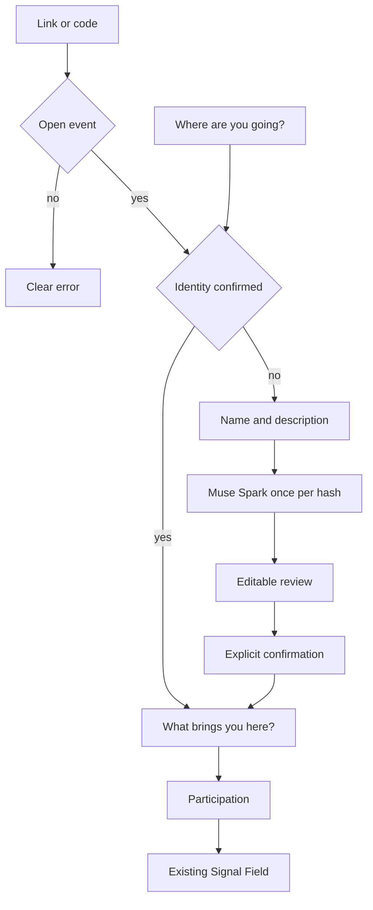

# Onboarding — event first

Professional identity is created once. Each event adds a distinct intent.

1. The user picks a real event, joins with a code, or creates one. No invented events. Counts come from `presence`.
2. Without a confirmed identity, only name and free-form description are asked.
3. Meta normalizes. The person corrects and presses “Save identity”.
4. An optional text stores that event’s context. It does not call Meta.
5. Someone who already confirmed identity does not rewrite it when changing events.

This screen replaces the previous long form. Signal Field presentation does not change.
